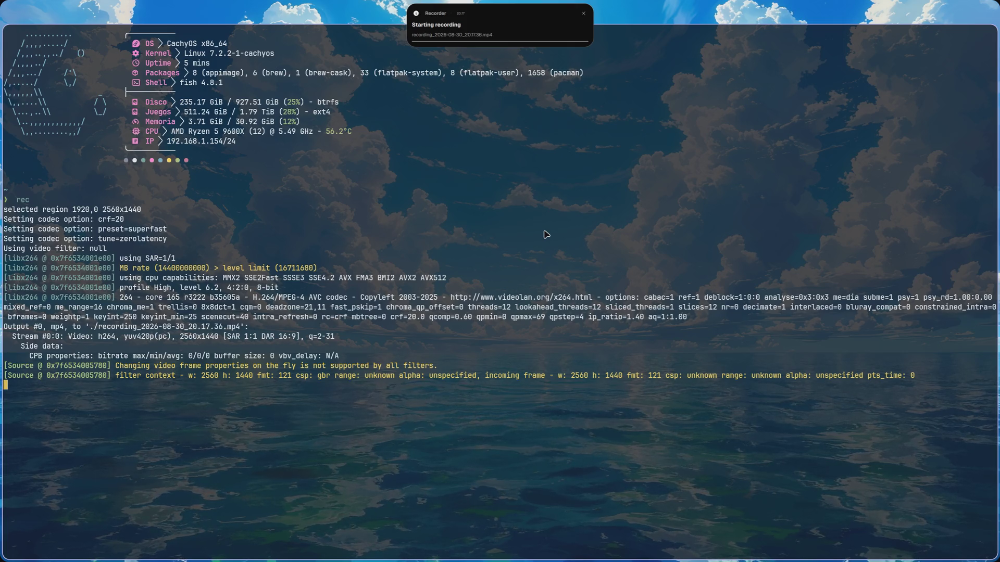

# 🪟 dotfiles-hyprland

<p align="center">
  
</p>

<p align="center">
  <a href="https://hyprland.org"></a>
  <a href="https://quickshell.outfoxxed.me"></a>
  <a href="https://www.lua.org"></a>
  <a href="https://pyside.org"></a>
</p>

<p align="center">
  A state-of-the-art, aesthetic, and modular <b>Hyprland</b> desktop environment powered by <b>Quickshell UI</b> (Unified Dynamic Island, Control Center, Multi-Distro Package Manager, Dashboard & Performance telemetry), <b>Wallfliper</b> video wallpapers, synchronized dual-monitor workspaces, and comprehensive screen intelligence utilities.
</p>

Part of the [dotfiles umbrella](https://github.com/blak0p/dotfiles).

---

## 🎬 Desktop Showcase

> [!TIP]
> Recorded showcase clips and demos are stored in `assets/hyprland-demo.mp4` and `assets/hyprland-demo.gif`.



---

## 📋 Table of Contents

- [What Gets Deployed](#what-gets-deployed)
- [Quickshell Desktop Architecture](#quickshell-desktop-architecture)
- [Wallfliper & Dynamic Theming](#wallfliper--dynamic-theming)
- [Key Features & Ergonomics](#key-features--ergonomics)
- [Comprehensive Keybindings Matrix](#comprehensive-keybindings-matrix)
- [Scripts & Backend Utilities](#scripts--backend-utilities)
- [Installation & Setup](#installation--setup)
- [Troubleshooting & Maintenance](#troubleshooting--maintenance)

---

## 📦 What Gets Deployed

The installer establishes clean symlinks from `~/.config/<name>` to this repository:

| Symlink | Configures | Description |
|---|---|---|
| `~/.config/hypr` | Hyprland WM | Window manager, rules, monitors, custom Lua config, hypridle, hyprlock, Wallfliper |
| `~/.config/quickshell` | Quickshell Desktop | Desktop bar surface, Unified Dynamic Island, Control Center, Overview, Package Manager |
| `~/.config/waybar` | Waybar | Minimalist alternative Wayland status bar |
| `~/.config/fuzzel` | Fuzzel | Minimalist Wayland app launcher and emoji selector |
| `~/.config/gtk-3.0` / `gtk-4.0` | GTK Theming | Dark/Light M3 theme, icon themes, typography |
| `~/.config/xsettingsd` | XSettings Daemon | DPI scaling and cursor theme synchronizer for XWayland |
| `~/.config/btop` | btop | System telemetry TUI theme matching the desktop palette |
| `~/.config/cava` | cava | Audio visualizer configuration for radial bar widgets |
| `~/.config/qt6ct` | Qt6 Settings | Qt appearance and font synchronization |

---

## 🏗️ Quickshell Desktop Architecture

The desktop UI is built upon **Quickshell (`ii` / Minflair Surface)**, featuring high-performance QML components with Spring animations:

### 1. Unified Dynamic Island (`UnifiedDynamicIsland.qml`)
Transitions fluidly across 4 operational modes:
* **Idle / Clock Mode (`clock`)**: Compact pill displaying active workspace indicator, avatar, interactive clock (`HH:mm • ddd, d MMM`), and overflow Control Center button.
* **Notification Notch Mode (`notif`)**: RichText popup with sender app icon, time elapsed, clickable URLs, image previews, inline interactive action buttons, and background progress bars. Pauses auto-dismissal timer on mouse hover.
* **App Launcher Mode (`launcher`)**: Keyboard-driven fuzzy application finder (`Super + Space`) with category filters and vectorized application icons.
* **Dashboard Dropdown (`dashboard`)**: Multi-tab drawer revealing:
  * **Dashboard Tab**: Mini music player, motivational quote widget, and system update tracker.
  * **Performance Tab (`Performance.qml`)**: Real-time telemetry cards:
    * `CpuCard.qml`: Model name, load percentage, temperature, frequency (GHz), and active core count.
    * `GpuCard.qml`: Dedicated/integrated GPU metrics (NVIDIA, AMD ROCm, Intel) with usage %, temperature, and VRAM.
    * `MemoryCard.qml`: RAM & Swap memory allocation gauges.
    * `StorageCard.qml`: Root and auxiliary disk usage.

### 2. Mini Music Player with 36-Radial Cava Visualizer (`MiniMusicWidget.qml`)
* Circular rotating album art synced with active MPRIS player.
* 36 radial audio bars animated in real-time via Cava FIFO stream.
* Full transport controls (Play/Pause, Previous/Next, Seekable Progress Bar).

### 3. Control Center (`ControlCenterView.qml`)
Houses 12 Quick Toggles and 7 specialized drawers:
* **Quick Toggles**: Wi-Fi, Bluetooth, Night Light (`hyprsunset`), DND / Silent, Keep Awake (`hypridle` inhibitor), **Game Mode** (instant toggle disabling blur, animations, and gaps for competitive latency), Power Profile, Dark/Light theme switcher, Screen Snip, Color Picker (`hyprpicker`), EasyEffects DSP, and Cloudflare WARP (`1.1.1.1`).
* **Sections**: Audio Mixer per-app, Bluetooth device manager, Wi-Fi credential portal, Notification History, Pomodoro Timer, To-Do list, and Calendar.

### 4. Multi-Distro Package Manager (`PackageManager.qml`)
* Native graphical package manager supporting **Arch / AUR** (`cachy-update`, `yay`, `paru`, `pacman`), **Fedora** (`dnf`), **Debian / Ubuntu** (`apt`), and **openSUSE** (`zypper`).
* Full batch operations: Search, Update, Install, and Clean Remove.

---

## 🖼️ Wallfliper & Dynamic Theming

Located at `hypr/wallfliper`, **Wallfliper** is a custom PySide6 / `wlr-layer-shell` wallpaper manager:
* **Still Images & Looping Videos**: Renders images with `swww` and video loops with GPU-accelerated `mpvpaper`.
* **Audition Mode (`Space`)**: Audition wallpapers directly on your live desktop while keeping the picker open.
* **Live Video Previews**: Hovering video entries plays animated thumbnail clips right on the selector cards.
* **Material You Sync (`switchwall.sh`)**: Automatic extraction of tonal palettes with Matugen, propagating live accent colors across Quickshell, Kitty, GTK, Qt, and Neovim.

---

## 🌟 Key Features & Ergonomics

1. **Dual-Monitor Workspace Sync (`ws_both`)**:
   * Pressing `Super + 1..9` seamlessly shifts workspaces on **both monitors in tandem** (`HDMI-A-2` & `DP-2`), eliminating multi-screen workspace desynchronization.
2. **Workspace Rename Modal (`Super + R`)**:
   * Spotlight/Rofi modal to rename the active workspace on the fly, instantly reflected on Quickshell's bar.
3. **Responsive Window Borders**:
   * 2px lavender accent border (`rgba(c2c1ffee)`) on active windows with subtle inactive borders (`rgba(47464f88)`).
4. **Intelligent Screen Utilities**:
   * **Region Snip (`Ctrl + Win + S` / `Super + Shift + S`)**: Saves to `~/Pictures/Screenshots/` and copies to clipboard.
   * **OCR Extraction (`Super + Shift + X`)**: Optical character recognition via Tesseract to clipboard.
   * **Google Lens Search (`Super + Shift + A`)**: Image search directly in browser.
   * **Screen Translation (`Super + Shift + T`)**: Live overlay text translation.
   * **Screen Recording (`Ctrl + Alt + R` / `Super + Alt + R`)**: Hardware-accelerated recording with audio support.
   * **AI Primary Buffer Query (`Super + Shift + Alt + Right Click`)**: Instant local LLM (Ollama) summary of selected text.
   * **VM Submap (`Super + Alt + F1`)**: Isolates input for virtual machines and remote desktop sessions.

---

## ⌨️ Comprehensive Keybindings Matrix

### Window Management & Tiling
| Shortcut | Action | Description |
|---|---|---|
| `Super + Return` / `Super + T` | Open Terminal | Launches Kitty terminal |
| `Super + C` / `Super + Q` | Close Window | Closes the active window cleanly |
| `Super + Shift + Alt + Q` | Force Kill | Destructive window termination (`hyprctl kill`) |
| `Super + F` | Toggle Fullscreen | True fullscreen mode |
| `Super + D` | Maximize Window | Maximizes window within borders |
| `Super + Alt + Space` | Toggle Floating | Switches between tiled and floating mode |
| `Super + P` | Pin Window | Pins window across all workspaces |
| `Super + J` | Cycle Window Focus | Rotates focus across windows on the active monitor |
| `Super + H` | Rotate Monitor Focus | Cycles focus between monitors |
| `Super + Left` / `Super + Right` | Move Window to Monitor | Moves active window to the other monitor |
| `Super + Shift + Arrows` | Move Window | Moves window position in layout |
| `Super + ;` / `Super + '` | Split Ratio | Adjusts split ratio (-0.1 / +0.1) |
| `Super + LMB Drag` | Move Floating | Drags floating window |
| `Super + RMB Drag` | Resize Window | Resizes window with mouse |

### Workspace Navigation
| Shortcut | Action | Description |
|---|---|---|
| `Super + 1..9, 0` | **Sync Dual Workspaces** | Shifts workspace across both monitors simultaneously (`ws_both`) |
| `Super + Alt + 1..9, 0` | Send to Workspace | Moves active window to workspace `1..9` |
| `Ctrl + Super + H` / `Ctrl + Super + L` | Relative Workspace | Shifts to previous / next workspace (`r-1` / `r+1`) |
| `Super + R` | **Rename Workspace** | Opens Rofi modal to rename active workspace |
| `Super + Alt + S` | Send to Scratchpad | Sends window to special scratchpad |
| `Super + Mouse 275` | Toggle Scratchpad | Reveals / hides special scratchpad |

### Desktop Shell & UI
| Shortcut | Action | Component |
|---|---|---|
| `Super + Space` | App Launcher | Dynamic Island search mode |
| `Super + Tab` | Workspace Overview | Graphical overview grid with drag-and-drop |
| `Super + N` | Control Center | Right sidebar with toggles & notifications |
| `Super + V` | Clipboard History | Cliphist fuzzy selector with previews |
| `Super + Period (.)` | Emoji Picker | Fuzzel emoji menu |
| `Super + Slash (/)` | Cheatsheet | Interactive shortcut guide |
| `Ctrl + Super + T` | Wallfliper | Wallpaper & video wallpaper picker |
| `Ctrl + Super + R` | Restart Shell | Reloads Quickshell UI stack |
| `Ctrl + Alt + Delete` | Power Menu | Lock, Suspend, Logout, Reboot, Shutdown |

### Screen Utilities, Recording & AI
| Shortcut | Action | Output / Destination |
|---|---|---|
| `Ctrl + Win + S` | **Region Snip** | `~/Pictures/Screenshots/` + Clipboard |
| `Print` | **Fullscreen Snip** | Clipboard |
| `Ctrl + Print` | **Fullscreen Snip & Save** | `~/Pictures/Screenshots/` + Clipboard |
| `Super + Shift + X` | **OCR Text Extraction** | Clipboard |
| `Super + Shift + A` | **Google Lens Search** | Default Web Browser |
| `Super + Shift + T` | **Screen Translation** | Live Screen Overlay |
| `Super + Shift + C` | **Color Picker** | Clipboard (`#HEX`) |
| `Ctrl + Alt + R` | **Toggle Fullscreen Rec** | `~/Videos/` (`wf-recorder`) |
| `Super + Alt + R` | **Toggle Region Rec** | `~/Videos/` (`wf-recorder`) |
| `Super + Shift + Alt + R` | **Toggle Rec with Audio** | `~/Videos/` (PipeWire Monitor Audio) |
| `Super + Shift + Alt + RMB` | **AI Text Query** | Ollama local LLM desktop notification |
| `Super + Alt + F1` | **VM Submap Toggle** | Direct input passthrough for VMs |

---

## 🛠️ Scripts & Backend Utilities

* **`quickshell/ii/scripts/colors/switchwall.sh`**: Computes Material 3 palettes from images via Matugen and syncs colors across applications.
* **`quickshell/ii/scripts/videos/record.sh`**: Multi-monitor screen recorder wrapper for `wf-recorder`.
* **`quickshell/ii/Scripts/search_packages.py`**: Multi-distro package query backend (Pacman, DNF, APT, Zypper).
* **`quickshell/ii/Scripts/get_processes.py`**: High-efficiency CPU and GPU telemetric reader (`/proc` and vendor sysfs).
* **`hypr/scripts/rename_workspace.sh`**: Rofi modal for Quickshell workspace state manipulation.
* **`hypr/scripts/ai/primary-buffer-query.sh`**: Wayland primary buffer query dispatcher for local Ollama models.

---

## ⚡ Installation & Setup

### Via the Umbrella Repository (Recommended)
```bash
git clone --recurse-submodules https://github.com/blak0p/dotfiles.git ~/dotfiles
cd ~/dotfiles
./install.sh --hyprland
```

### Standalone Installation
```bash
git clone https://github.com/blak0p/dotfiles-hyprland.git ~/.config/dotfiles-hyprland
cd ~/.config/dotfiles-hyprland
bash deps/install-deps.sh
./install.sh
```

---

## 🔧 Troubleshooting & Maintenance

### Reload Hyprland & Keybindings
```bash
hyprctl reload
```

### Restart Quickshell UI
```bash
killall ydotool qs quickshell; qs -c ii &
# Or press: Ctrl + Super + R
```

### Reset / Verify Screenshot Save Path
Screenshots automatically respect `~/.config/user-dirs.dirs` and `~/.config/illogical-impulse/config.json`:
```json
{
  "screenSnip": {
    "savePath": "/home/alejandro/Pictures/Screenshots"
  }
}
```

---

## 📄 License

MIT License. Designed and maintained by **blak0p**.
